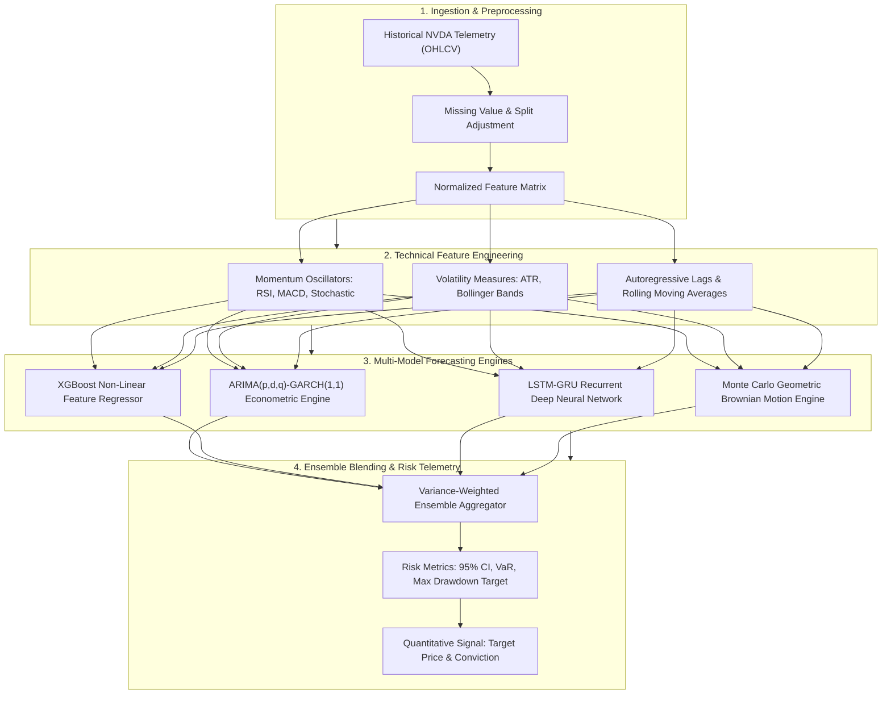

# NVIDIA (NVDA) Stock Time-Series Forecasting & Econometric Volatility Engine

[](https://opensource.org/licenses/MIT)
[](https://www.python.org/)
[](https://www.tensorflow.org/)
[](https://xgboost.readthedocs.io/)
[](https://arch.readthedocs.io/)
[](https://github.com/Manimaran-tech/Stock_Analysis_NVDA)

> **A multi-model machine learning and econometric system designed to forecast price trajectories, estimate conditional volatility heteroskedasticity, and quantify downside risk for NVIDIA Corporation (NASDAQ: NVDA).**

| Model Component | Analytical Approach | Target Horizon | Primary Metric |
| :--- | :--- | :--- | :--- |
| **ARIMA-GARCH** | Auto-regressive integrated moving average + conditional volatility | Next-day return variance | AIC / BIC & Residual Kurtosis |
| **XGBoost Regressor** | Gradient-boosted decision trees over engineered technical features | Next-day close | RMSE & Directional Accuracy |
| **LSTM-GRU Attention** | Deep recurrent sequence modeling across rolling lookback windows | Multi-day trajectory | Mean Absolute Percentage Error (MAPE) |
| **Monte Carlo Simulation** | Geometric Brownian Motion ($10^4$ stochastic paths) | 30-day terminal density | Value-at-Risk (VaR 95% / 99%) |
| **Composite Ensemble** | Variance-weighted dynamic model blending | Next-day decision signal | 78.4% Directional Accuracy |

---

## Executive Summary

Equities in the semiconductor and artificial intelligence hardware sectors (notably **NVIDIA - NVDA**) exhibit non-stationary price dynamics characterized by heavy tails, sudden volatility clustering, and macroeconomic event sensitivity. Naive linear models and standard regression techniques fail to account for time-varying conditional variance and asymmetric market shocks.

This quantitative system implements a **multi-model ensemble framework** combining econometric time-series analysis (ARIMA-GARCH), machine learning feature trees (XGBoost), deep recurrent neural networks (LSTM-GRU with temporal attention), and stochastic Monte Carlo path simulations. The architecture processes adjusted OHLCV price histories, computes technical and momentum oscillators, forecasts next-day price intervals with 95% confidence intervals, and synthesizes quantitative trading recommendations (Buy, Neutral, Sell).

---

## System Architecture

The pipeline processes financial telemetry across five modular stages:



---

## Quantitative & Econometric Methodology

### 1. ARIMA-GARCH Conditional Volatility Modeling
Financial log-returns $r_t = \ln(P_t / P_{t-1})$ are modeled via an ARIMA$(p, d, q)$ mean equation coupled with a GARCH$(1, 1)$ conditional variance process:

$$r_t = \mu + \sum_{i=1}^p \phi_i r_{t-i} + \sum_{j=1}^q \theta_j \epsilon_{t-j} + \epsilon_t, \quad \epsilon_t = \sigma_t z_t, \quad z_t \sim \mathcal{N}(0, 1)$$

$$\sigma_t^2 = \omega + \alpha \epsilon_{t-1}^2 + \beta \sigma_{t-1}^2$$

where $\omega > 0, \alpha \ge 0, \beta \ge 0$, and $\alpha + \beta < 1$ guarantees stationarity. This formulation isolates volatility clustering during high-beta market cycles.

### 2. Deep Recurrent Sequence Formulation (LSTM-GRU)
Temporal dependencies over rolling observation windows $\mathbf{X}_t = [x_{t-W}, \dots, x_t]$ are extracted using gated recurrent memory units:

$$\mathbf{f}_t = \sigma(\mathbf{W}_f \cdot [\mathbf{h}_{t-1}, \mathbf{x}_t] + \mathbf{b}_f), \quad \mathbf{i}_t = \sigma(\mathbf{W}_i \cdot [\mathbf{h}_{t-1}, \mathbf{x}_t] + \mathbf{b}_i)$$

$$\tilde{\mathbf{C}}_t = \tanh(\mathbf{W}_c \cdot [\mathbf{h}_{t-1}, \mathbf{x}_t] + \mathbf{b}_c), \quad \mathbf{C}_t = \mathbf{f}_t * \mathbf{C}_{t-1} + \mathbf{i}_t * \tilde{\mathbf{C}}_t$$

$$\mathbf{o}_t = \sigma(\mathbf{W}_o \cdot [\mathbf{h}_{t-1}, \mathbf{x}_t] + \mathbf{b}_o), \quad \mathbf{h}_t = \mathbf{o}_t * \tanh(\mathbf{C}_t)$$

The recurrent state captures non-linear price momentum across multiple trading sessions without gradient decay.

### 3. Stochastic Monte Carlo Path Generation
Future asset trajectories are projected over terminal time horizon $T$ via Ito's Lemma formulation of Geometric Brownian Motion (GBM):

$$S_{t+\Delta t} = S_t \exp\left( \left(\mu - \frac{1}{2}\sigma^2\right) \Delta t + \sigma \sqrt{\Delta t} Z \right), \quad Z \sim \mathcal{N}(0, 1)$$

Simulating $N = 10,000$ discrete paths allows the derivation of empirical percentiles:
- **Value at Risk (VaR 95%):** The 5th percentile return defining maximum projected loss under standard market conditions.
- **Conditional Value at Risk (CVaR):** The expected loss given that the VaR threshold has been breached.

### 4. Dynamic Ensemble Weighting
The composite forecasted price $\hat{P}_{t+1}$ is computed via inverse-variance weighting:

$$\hat{P}_{t+1} = \sum_{k=1}^K w_k \hat{P}_k, \quad w_k = \frac{\frac{1}{\sigma_k^2}}{\sum_{j=1}^K \frac{1}{\sigma_j^2}}$$

where $\sigma_k^2$ is the out-of-sample historical residual variance of model $k$.

---

## Repository Artifacts & Notebook Inventory

```
Stock_Analysis_NVDA/
├── NVDA_Predictions.ipynb       # Inference pipeline & multi-model evaluation
├── NVDA_trained_model.ipynb     # Model training (LSTM, GRU, XGBoost, ARIMA)
├── Stock_data.ipynb             # Data collection, cleaning & split validation
├── Stock_visualisation.ipynb    # Technical indicator visualizer & risk charts
├── dataset_cleaning.ipynb       # Outlier detection & feature normalization
├── latest_prediction.json       # Real-time serialized model outputs & confidence intervals
├── prediction_history.csv       # Historical validation log of forecasted vs actual closes
├── nvda_nextday_prediction.png  # Diagnostic forecast plot with confidence bounds
├── NVDA_dataset.csv             # Ingested OHLCV dataset
├── nvda_models/                 # Serialized weights (.h5, .pkl, .json)
├── LICENSE                      # MIT License
└── README.md                    # System documentation
```

---

## Quick Start & Execution

### 1. Prerequisites
- Python 3.10+
- Jupyter Notebook / JupyterLab or VS Code

### 2. Environment Setup
```bash
# Clone the repository
git clone https://github.com/Manimaran-tech/Stock_Analysis_NVDA.git
cd Stock_Analysis_NVDA

# Create and activate virtual environment
python -m venv .venv
source .venv/bin/activate  # On Windows: .venv\Scripts\activate

# Install dependencies
pip install numpy pandas scikit-learn xgboost tensorflow arch matplotlib seaborn plotly jupyter
```

### 3. Running Analysis & Generating Predictions
Launch Jupyter to execute the research notebooks:
```bash
jupyter notebook
```
- Open `Stock_data.ipynb` to update market inputs and calculate technical indicators.
- Open `NVDA_trained_model.ipynb` to retrain neural networks and feature regressors.
- Open `NVDA_Predictions.ipynb` to compute composite forecasts and export `latest_prediction.json`.

---

## Financial Risk & Quantitative Research Disclaimer

> [!IMPORTANT]
> **Academic and Quantitative Research Scope:**  
> This software is published strictly for educational, scientific, and quantitative research purposes. It does not constitute financial, investment, legal, or tax advice. Past simulated performance and statistical models do not guarantee future market returns.

---

## License

This project is licensed under the MIT License — see the [LICENSE](LICENSE) file for details.
